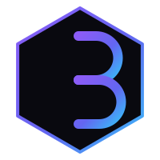
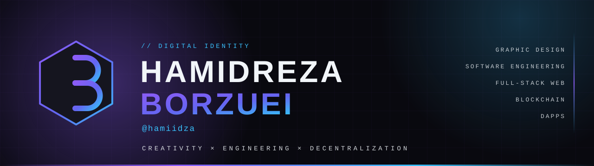

<!--
  HAMIDREZA BORZUEI | hamiidza
  GitHub profile README
  Keep this repository named exactly: hamiidza
-->

<p align="center">
  
</p>

<p align="center">
  
</p>

<p align="center">
  <a href="https://github.com/hamiidza"></a>
  <a href="https://instagram.com/hamiidza"></a>
  <a href="https://t.me/hamiidza"></a>
  <a href="mailto:hamidrezaborzueii@gmail.com"></a>
</p>

<p align="center">
  <strong>CREATIVITY&nbsp; × &nbsp;ENGINEERING&nbsp; × &nbsp;DECENTRALIZATION</strong>
</p>

---

## 01 — About Me

I'm **Hamidreza Borzuei**, known online as **[hamiidza](https://github.com/hamiidza)**.

My background brings together **graphic design**, **computer software engineering**, **full-stack web development**, and an interest in **blockchain and decentralized applications (DApps)**.

I enjoy working where visual thinking meets engineering: understanding a problem, shaping a clear experience, and building software with thoughtful structure. My multidisciplinary perspective connects how a product looks, how it works, and how its underlying systems are designed.

> **Design with intention. Engineer with precision. Build beyond boundaries.**

<p align="center">
  
</p>

## 02 — Education

**Computer Software Engineering**  
Public University (Iran) · **2011–2016**

<p align="center">
  
</p>

## 03 — Professional Domains

| Domain | Areas of focus |
|---|---|
| **Graphic Design** | Visual communication, graphic composition, digital design, and visual problem-solving |
| **Software Engineering** | Programming principles, structured problem-solving, software design, and maintainable systems |
| **Full-Stack Web Development** | Frontend and backend application development, APIs, data flows, and web experiences |
| **Blockchain & DApps** | Blockchain-oriented applications, decentralized product concepts, and Web3 development |

*These are the professional areas that define my background and interests; this profile does not imply a specific certification or claim expertise in every tool in these fields.*

<p align="center">
  
</p>

## 04 — Technology & Toolkit

My work spans design and software development. I’m keeping this section intentionally focused on disciplines rather than publishing an unverified list of languages, frameworks, or tools. As public repositories and project documentation are added, this section can evolve into a stack backed by actual project evidence.

- **Design:** visual communication and digital design
- **Engineering:** software development and problem-solving
- **Web:** frontend, backend, and full-stack application development
- **Web3:** blockchain and decentralized application development

<p align="center">
  
</p>

## 05 — Engineering Philosophy

```text
DISCOVER     Understand the problem and its context
DESIGN       Shape a clear and considered experience
ARCHITECT    Give the solution a sound structure
BUILD        Turn ideas into working software
REFINE       Improve clarity, quality, and performance
EVOLVE       Learn, iterate, and keep moving forward
```

I value clear communication, considered design decisions, maintainable implementation, and solutions that serve a real purpose.

<p align="center">
  
</p>

## 06 — How I Approach Building

I approach digital products as connected systems: the visual layer, the user experience, the application logic, and the underlying architecture should support one another. I aim to make deliberate choices, keep complexity understandable, and improve a solution through iteration.

<p align="center">
  
</p>

## 07 — Featured Projects

**Project showcase coming soon.** This section is intentionally reserved for selected public repositories. Projects will be added after their scope, implementation, and technology choices have been reviewed.

<!--
  Add a project only after confirming its public repository and details.
  Suggested format:
  ### Project Name
  One-sentence description based on the actual implementation.
  - **Focus:** ...
  - **Repository:** https://github.com/hamiidza/REPOSITORY-NAME
-->

<p align="center">
  
</p>

## 08 — GitHub Statistics

<p align="center">
  
  
</p>

<p align="center">
  
</p>

<p align="center">
  
</p>

<sub>Statistics are generated by third-party services and may be delayed, rate-limited, or unavailable. Private contribution visibility depends on GitHub settings and the service's support.</sub>

<p align="center">
  
</p>

## 09 — Current Interests

- Modern software architecture and thoughtful application design
- Full-stack web development
- Blockchain ecosystems and decentralized applications
- Creative technology and the relationship between design and code
- Open-source development and continuous learning

<p align="center">
  
</p>

## 10 — Connect

I'm open to thoughtful conversations, knowledge-sharing, and collaboration around design, software engineering, web development, and decentralized technology.

<p align="center">
  <a href="https://github.com/hamiidza">GitHub</a>&nbsp; · &nbsp;
  <a href="https://instagram.com/hamiidza">Instagram</a>&nbsp; · &nbsp;
  <a href="https://t.me/hamiidza">Telegram</a>&nbsp; · &nbsp;
  <a href="mailto:hamidrezaborzueii@gmail.com">Email</a>
</p>

<p align="center">
  
</p>

## 11 — A Note on This Profile

This profile is a living introduction, not a list of inflated claims. Project highlights and specific technologies will be added as they are documented in public repositories.

<p align="center">
  
</p>

<p align="center">
  <sub>HAMIDREZA BORZUEI · hamiidza</sub>
</p>
