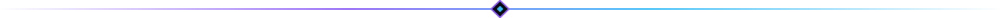
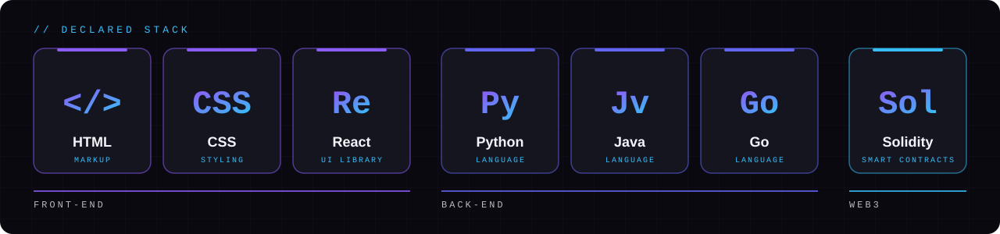

 

## 02 — Introduction

> **Creativity × Engineering × Decentralization**

I'm **Hamidreza Borzuei** (`hamiidza`), a multidisciplinary creative software engineer.
My work sits where visual communication meets software architecture: from layout, type and identity to full-stack web applications and decentralized applications (DApps).

I treat design and engineering as one discipline: clear structure underneath, deliberate form on top.

## 03 — Education

|   |   |
|---|---|
| **Computer Software Engineering** | State University &nbsp;·&nbsp; 2011–2016 |

## 04 — Professional Domains

<table>
  <tr>
    <td width="25%" valign="top"><h4>🎨 Graphic Design</h4>Visual communication, identity and layout.</td>
    <td width="25%" valign="top"><h4>⚙️ Software Engineering</h4>Structured, maintainable systems.</td>
    <td width="25%" valign="top"><h4>🌐 Full-Stack Web</h4>Interfaces and the services behind them.</td>
    <td width="25%" valign="top"><h4>⛓️ Blockchain &amp; DApps</h4>Decentralized application development.</td>
  </tr>
</table>

## 05 — Technology Stack

Declared by the owner. The card below is measured automatically from public repositories.

**Languages measured from my public repositories**

<!--
  OPTIONAL: add a verified tool line here only for technologies you have confirmed in your own repositories.
  Example (Skill Icons, replace ids with the ones you verified):
  
-->

## 06 — Engineering Philosophy

<table>
  <tr>
    <td width="33%" valign="top"><h4>Design with intention</h4>Every element earns its place.</td>
    <td width="33%" valign="top"><h4>Engineer with precision</h4>Clean structure, predictable behavior.</td>
    <td width="33%" valign="top"><h4>Build beyond boundaries</h4>Connect design, code and decentralization.</td>
  </tr>
</table>

## 07 — Featured Projects

<table>
  <tr>
    <td width="50%"></td>
    <td width="50%"></td>
  </tr>
  <tr>
    <td width="50%"></td>
    <td width="50%"></td>
  </tr>
</table>

## 08 — GitHub Statistics

## 09 — Current Interests

- Decentralized application (DApp) development
- Full-stack web architecture
- Visual identity and interface design for technical products

## 10 — Social & Contact

| Channel | Link |
|---|---|
| GitHub | [github.com/hamiidza](https://github.com/hamiidza) |
| Telegram | [t.me/hamiidza](https://t.me/hamiidza) |
| Instagram | [instagram.com/hamiidza](https://instagram.com/hamiidza) |
| Email | [hamidrezaborzueii@gmail.com](mailto:hamidrezaborzueii@gmail.com) |

